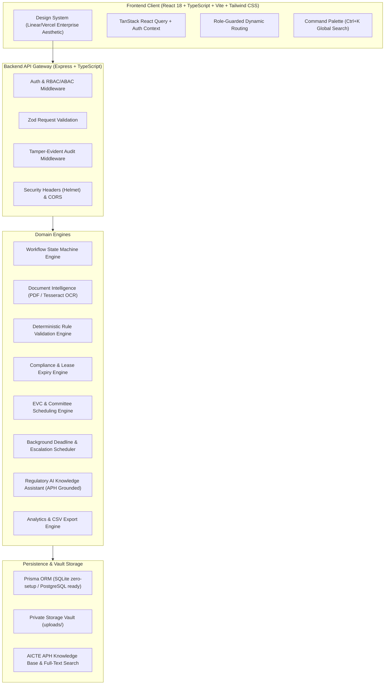

# RegulaFlow AI
### Integrated AICTE Approval Workflow Automation, Compliance Monitoring and Alert Management System
**Smart India Hackathon 2026** | **Problem Statement ID:** SIH26262  
**Theme:** Smart Automation | **Category:** Software  
**Tagline:** *Every approval tracked. Every deadline protected. Every action accountable.*

---

## 1. Executive Summary & Problem Statement

Approval processes for technical and higher education institutions governed by the All India Council for Technical Education (AICTE) involve multi-stage scrutiny, institutional deeds, officer assignments, expert visiting committee (EVC) inspections, anti-ragging undertakings, 30-year registered lease validities, annual renewal deadlines, and complex compliance covenants under the AICTE Approval Process Handbook (APH).

When managed via fragmented channels or disconnected systems, regulatory stakeholders face acute challenges:
- **Opaque Application Movement:** Inability to track where an application is stalled across scrutiny stages.
- **Manual & Error-Prone Scrutiny:** Sifting through hundreds of pages of deeds and NOCs to verify validity dates and carpet area norms.
- **Compliance Lapses:** Expirations of land leases, fire safety certificates, or endowment fund FDRs slipping past unmonitored.
- **Lack of Traceability:** Absence of an immutable, verifiable audit trail of who made, modified, or approved regulatory findings.

### The RegulaFlow AI Solution

RegulaFlow AI unites all statutory regulatory operations into an enterprise-grade platform:
1. **Application Lifecycle State Machine:** Strict stage-wise routing (`DRAFT` &rarr; `SUBMITTED` &rarr; `UNDER_SCRUTINY` &rarr; `DEFICIENCY_RAISED` &rarr; `RETURNED_FOR_CORRECTION` &rarr; `RESUBMITTED` &rarr; `AWAITING_EVC` &rarr; `UNDER_REVIEW` &rarr; `APPROVED`/`REJECTED`).
2. **Document Intelligence & OCR Pipeline:** Tesseract OCR and native PDF text extraction with automatic regex entity bindings (Lessor, Lessee, Tenure, Expiry Date, Carpet Area, Notarization).
3. **Deterministic Rule Validation Engine:** Evaluates mandatory document completeness, fire safety NOC validity, and lease tenure rules without hallucination.
4. **Evidence-Linked Deficiencies:** Cites exact excerpt passages from uploaded documents for officer verification.
5. **Covenant & Compliance Monitoring:** Continuous background scheduler tracking 30-year leases, fire NOC renewals, and affidavit undertakings with automated escalations.
6. **EVC Committee Scheduling:** Conflict-aware scheduling of physical/hybrid inspections with GIS checklist verification.
7. **Grounded Regulatory RAG Assistant:** An AI consultation assistant grounded in the official AICTE Approval Process Handbook (APH 2024-2027) with verified chapter and page citations.
8. **Forensic Audit Journal:** Captures before/after state diffs on every state transition and review action.

---

## 2. System Architecture



---

## 3. Technology Stack

- **Frontend:** React 18, TypeScript, Vite, Tailwind CSS, TanStack React Query, React Router DOM, Recharts, Lucide Icons.
- **Backend:** Node.js (v24), TypeScript, Express, Zod validation, Prisma ORM, JSON Web Tokens (JWT), BcryptJS, Node-Cron, Multer.
- **Document Intelligence:** `pdf-parse` (selectable text stream extraction) + `tesseract.js` (optical character recognition).
- **Database:** SQLite (default zero-friction local development) + PostgreSQL schema and Docker Compose configuration for enterprise deployment.
- **AI & RAG:** Grounded retrieval over the AICTE Approval Process Handbook (APH 2024-2027) with Groq LLM adapter (`llama-3.1-70b-versatile`) and deterministic local fallback.
- **Testing:** Vitest, Supertest.

---

## 4. Project Directory Structure

```text
SIH_NEXUS/
├── apps/
│   ├── web/                          # React + TypeScript Frontend
│   │   ├── src/
│   │   │   ├── components/           # CommandPalette, Modals, Badges
│   │   │   ├── context/              # AuthContext & Demo Role Switcher
│   │   │   ├── layouts/              # AppLayout, Sidebar, TopNav
│   │   │   ├── pages/                # Dashboard, Apps, Detail, Docs, Compliance, EVC, Assistant, Reports, Audit
│   │   │   ├── services/             # Axios API Client
│   │   │   ├── types/                # Frontend Domain Types
│   │   │   └── App.tsx               # Route Configuration
│   │   ├── package.json
│   │   ├── tailwind.config.js
│   │   └── vite.config.ts
│   └── api/                          # Express + TypeScript Backend
│       ├── src/
│       │   ├── config/               # Environment Configuration
│       │   ├── jobs/                 # Deadline & Escalation Scheduler
│       │   ├── middleware/           # auth, rbac, upload, audit, errorHandler
│       │   ├── modules/              # auth, applications, documents, ocr, validation, compliance, evc, reports, audit, assistant
│       │   ├── services/             # workflowEngine, ocrService, validationEngine, ragService, db
│       │   └── server.ts             # Express Application Bootstrap
│       ├── tests/                    # Vitest API Test Suite
│       ├── uploads/                  # Private Document Storage Vault
│       ├── package.json
│       └── tsconfig.json
├── packages/
│   └── shared/                       # Shared Enums, Types & Constants
├── prisma/
│   ├── schema.prisma                 # SQLite Schema
│   ├── schema.postgresql.prisma      # PostgreSQL Production Schema
│   └── seed.ts                       # Realistic Synthetic Demonstration Seeder
├── docs/                             # Complete Technical Documentation
│   ├── ARCHITECTURE.md
│   ├── DATABASE.md
│   ├── API.md
│   ├── SECURITY.md
│   ├── TESTING.md
│   ├── USER_GUIDE.md
│   └── DEMO_SCRIPT.md
├── docker-compose.yml
├── .env.example
├── package.json                      # Workspaces Root
└── README.md
```

---

## 5. Prerequisites & Quick Start Guide

### Prerequisites
- **Node.js:** v18.0.0 or higher (v24.18.0 tested)
- **npm:** v9.0.0 or higher

### Step 1: Install Dependencies
```bash
npm install
```

### Step 2: Build Shared Types Package
```bash
npm run build --workspace=@regulaflow/shared
```

### Step 3: Setup & Seed Database
Pushes the schema to the zero-setup local SQLite database (`prisma/dev.db`) and seeds realistic synthetic institutions, applications, OCR extractions, and APH knowledge chunks:
```bash
npm run prisma:push
npm run prisma:seed
```

### Step 4: Run the Backend & Frontend

In Terminal 1 (Start Backend API Server on `http://localhost:5000`):
```bash
npm run dev:api
```

In Terminal 2 (Start Frontend Web App on `http://localhost:5173`):
```bash
npm run dev:web
```

Open your browser at **`http://localhost:5173`**.

---

## 6. Demo Evaluation Accounts

Pre-configured role accounts (Password: `Password@123`):

| Role | Email | Key Capabilities |
|---|---|---|
| **Regional Officer** | `officer.north@regulaflow.aicte.gov.in` | Scrutiny review, deficiency citation, stage transitions |
| **Institution Principal** | `institution@regulaflow.aicte.gov.in` | Create applications, upload proofs, resolve deficiencies |
| **Bureau Officer** | `bureau.chief@regulaflow.aicte.gov.in` | Executive oversight, review queues, statutory decisions |
| **Committee Member** | `committee.expert@regulaflow.aicte.gov.in` | EVC inspection schedule, observation report submission |
| **System Administrator** | `admin@regulaflow.aicte.gov.in` | System health, user directory, immutable audit trail |

> **Evaluator Convenience:** On any screen, use the **"Role: [Role Name]"** dropdown in the top navigation bar to switch between roles in 1 click!

---

## 7. Running Automated Tests

RegulaFlow AI includes automated integration tests covering the complete regulatory lifecycle:
```bash
npm run test --workspace=@regulaflow/api
```

**Test Execution Outcome:**
- `GET /api/health` — 200 OK
- `POST /api/v1/auth/login` — 200 OK (verified JWT & bcrypt)
- `POST /api/v1/auth/login` (invalid credentials) — 401 Unauthorized
- `POST /api/v1/auth/demo-login` — 200 OK
- `GET /api/v1/applications` — 200 OK (role-scoped data)
- `GET /api/v1/applications` (unauthorized) — 401 Unauthorized
- `GET /api/v1/compliance` — 200 OK (aggregate covenant metrics)
- `POST /api/v1/compliance/check` — 200 OK (deadline scheduler execution)
- `POST /api/v1/assistant/query` — 200 OK (grounded APH handbook citations)

**Result: 9 of 9 tests passing (100%).**

---

## 8. Verifiable User Journeys

- **Journey A (Application Creation & Scrutiny):** Log in as Institution User &rarr; Create Application &rarr; Upload Land Deed & Fire NOC &rarr; Submit &rarr; Switch to Regional Officer &rarr; Review stage movement in real-time.
- **Journey B (Evidence-Linked Deficiency Flagging):** Open application `AICTE/2026-27/APP-00102` &rarr; Observe `VAL_FIRE_NOC_EXPIRED` &rarr; Read exact cited certificate validity passage &rarr; Resolve or return for correction.
- **Journey C (Covenant & Deadline Escalation):** Open Compliance Center &rarr; Click *"Run Deadline Evaluation"* &rarr; Observe background scheduler evaluating warning windows & generating escalation records.
- **Journey D (EVC Inspection Scheduling):** Open EVC & Committees &rarr; Schedule new visit &rarr; Experience conflict detection &rarr; Submit factual committee report.
- **Journey E (Regulatory AI Q&A):** Open Regulatory Assistant &rarr; Ask about Land Norms, Faculty-Student Ratio (SFR 1:20), or Fire Safety &rarr; Receive grounded citations from APH Handbook.
- **Journey F (Forensic Audit Trail):** Open Audit Trail &rarr; Filter by action &rarr; Inspect before/after state mutation diffs.

---

## 9. Security & Governance

1. **Strict Data Isolation:** Institutions can never access documents or applications of other institutions (`403 Forbidden`).
2. **Private Document Storage:** Documents are stored in `uploads/` outside the web root; downloads are streamed through authenticated endpoints.
3. **AI Safety Boundaries:** AI is strictly partitioned to extraction, summarization, and citation retrieval. Official approval decisions remain under the exclusive statutory authority of authorized officials.

---

## 10. Documentation Directory

- [`docs/ARCHITECTURE.md`](file:///C:/SIH_NEXUS/docs/ARCHITECTURE.md) — System Architecture, Component Flow & State Machine
- [`docs/DATABASE.md`](file:///C:/SIH_NEXUS/docs/DATABASE.md) — Relational Entity Model & Field Documentation
- [`docs/API.md`](file:///C:/SIH_NEXUS/docs/API.md) — REST API Endpoints & Request/Response Schemas
- [`docs/SECURITY.md`](file:///C:/SIH_NEXUS/docs/SECURITY.md) — Security Boundaries, Access Control & AI Safety
- [`docs/TESTING.md`](file:///C:/SIH_NEXUS/docs/TESTING.md) — Test Architecture & Verification Report
- [`docs/USER_GUIDE.md`](file:///C:/SIH_NEXUS/docs/USER_GUIDE.md) — Step-by-Step Role Manuals
- [`docs/DEMO_SCRIPT.md`](file:///C:/SIH_NEXUS/docs/DEMO_SCRIPT.md) — 5-Minute SIH Jury Demonstration Script

---

## 11. Disclaimer

*RegulaFlow AI is an independent prototype developed for the Smart India Hackathon 2026 (Problem Statement ID: SIH26262). It references publicly available guidelines from the AICTE Approval Process Handbook (APH 2024-2027) for demonstration and evaluation purposes and does not claim official affiliation or live integration with statutory AICTE production servers unless independently established.*
