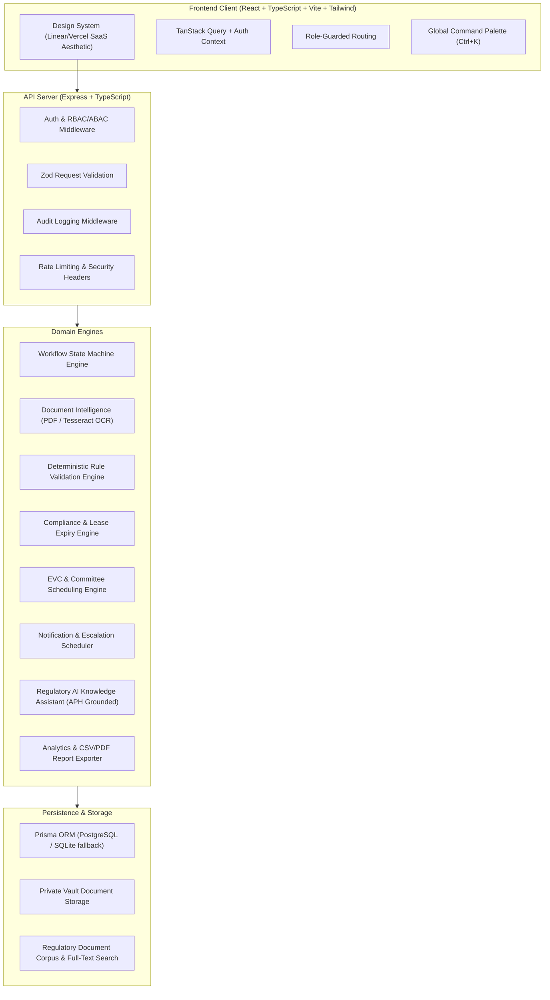
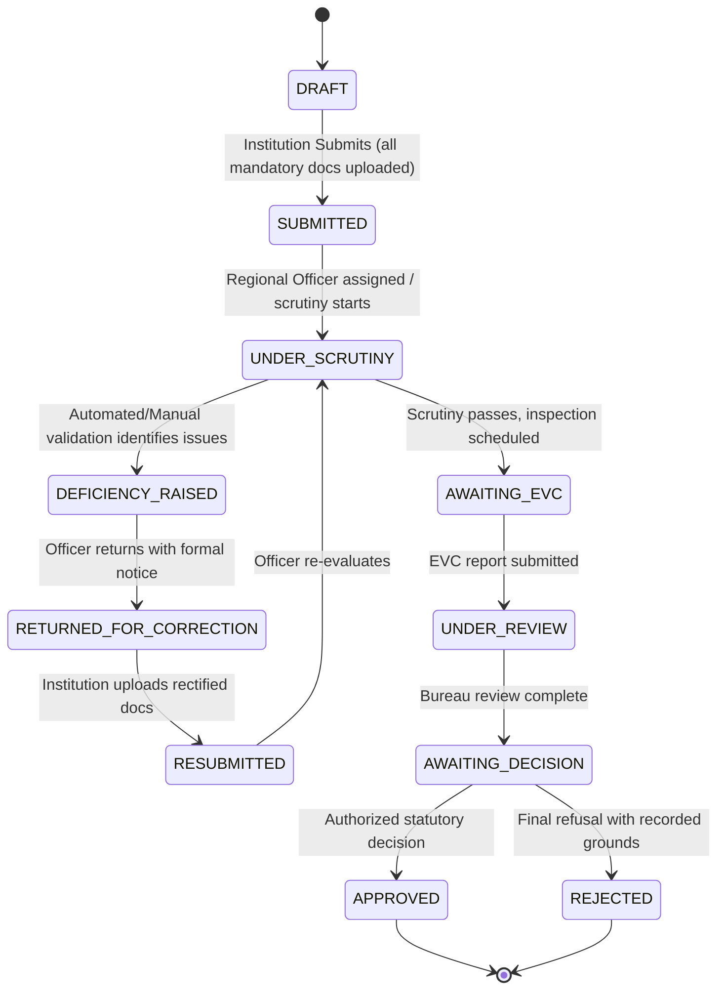

# RegulaFlow AI — Comprehensive Architecture & Implementation Plan
**Problem Statement ID:** SIH26262 | Smart India Hackathon 2026
**Theme:** Smart Automation | **Category:** Software
**Product:** RegulaFlow AI — Integrated AICTE Approval Workflow Automation, Compliance Monitoring and Alert Management System

---

## 1. Executive Summary & Architectural Overview

RegulaFlow AI is designed as a mission-critical regulatory platform that eliminates fragmentation, lack of transparency, and compliance lapses in statutory higher education institutional approvals (AICTE Approval Process Handbook).



---

## 2. Monorepo Project Structure

```text
c:\SIH_NEXUS\
├── apps\
│   ├── web\                       # Frontend Application
│   │   ├── src\
│   │   │   ├── components\        # UI components (Button, Modal, Table, Badge, Card, etc.)
│   │   │   ├── features\          # Domain views (Applications, Scrutiny, Compliance, EVC, etc.)
│   │   │   ├── layouts\           # AppShell, Sidebar, TopNav, AuthLayout
│   │   │   ├── context\           # AuthContext, ThemeContext, NotificationContext
│   │   │   ├── hooks\             # Custom hooks (useApplications, useCompliance, etc.)
│   │   │   ├── services\          # API client (Axios/Fetch with interceptors)
│   │   │   └── types\             # Frontend TypeScript types
│   │   ├── package.json
│   │   ├── tailwind.config.js
│   │   └── vite.config.ts
│   └── api\                       # Backend Application
│       ├── src\
│       │   ├── modules\           # Feature modules (auth, apps, workflows, docs, etc.)
│       │   ├── middleware\        # rbac, errorHandler, upload, rateLimiter, auditLog
│       │   ├── services\          # workflowEngine, ocrService, validationEngine, ragService
│       │   ├── jobs\              # scheduler (deadline checks, escalations, reminders)
│       │   ├── config\            # environment variables, constants
│       │   └── server.ts          # Express bootstrapping
│       ├── uploads\               # Private protected document storage
│       ├── package.json
│       └── tsconfig.json
├── packages\
│   └── shared\                    # Shared Types, Schemas, Constants
│       ├── src\
│       │   ├── types.ts
│       │   ├── enums.ts
│       │   └── constants.ts
│       └── package.json
├── prisma\
│   ├── schema.prisma              # Complete relational model
│   └── seed.ts                    # Realistic synthetic SIH demo data
├── docs\                          # Enterprise Documentation
│   ├── ARCHITECTURE.md
│   ├── DATABASE.md
│   ├── API.md
│   ├── SECURITY.md
│   ├── TESTING.md
│   ├── USER_GUIDE.md
│   └── DEMO_SCRIPT.md
├── docker-compose.yml
├── .env.example
├── package.json                   # Root package.json with npm workspaces
└── README.md
```

---

## 3. Database Schema Entities & Relationships

The relational model includes:
1. **User**: ID, email, passwordHash, fullName, role (`INSTITUTION_USER`, `REGIONAL_OFFICER`, `BUREAU_OFFICER`, `COMMITTEE_MEMBER`, `ADMIN`), phone, regionId, institutionId, active, createdAt, updatedAt.
2. **Institution**: ID, code (e.g. `1-109723451`), name, type (`ENGINEERING`, `MANAGEMENT`, `PHARMACY`, `POLYTECHNIC`, `ARCHITECTURE`), address, city, state, region (`NORTHERN`, `WESTERN`, `SOUTHERN`, `EASTERN`, `CENTRAL`, `SOUTH_WESTERN`), contactEmail, contactPhone, establishedYear.
3. **Application**: ID, applicationNumber (`AICTE/2026-27/APP-XXXXX`), institutionId, academicYear (`2026-2027`), category (`EXTENSION_OF_APPROVAL`, `NEW_INSTITUTION`, `INCREASE_IN_INTAKE`, `NEW_PROGRAMME`, `CLOSURE`), currentStage (`DRAFT`, `SUBMITTED`, `UNDER_SCRUTINY`, `DEFICIENCY_RAISED`, `RETURNED_FOR_CORRECTION`, `RESUBMITTED`, `UNDER_REVIEW`, `AWAITING_EVC`, `AWAITING_DECISION`, `APPROVED`, `REJECTED`, `CLOSED`), assignedOfficerId, submissionDate, deadlineDate, priority (`NORMAL`, `HIGH`, `URGENT`), metadata (JSON: courses, intake, faculty count, built-up area).
4. **ApplicationDocument**: ID, applicationId, documentType (`LAND_TITLE_LEASE_DEED`, `OCCUPANCY_CERTIFICATE`, `FIRE_SAFETY_NOC`, `BUILDING_PLAN_SANCTION`, `AICTE_UNDERTAKING_AFFIDAVIT`, `BALANCE_SHEET_AUDIT`), fileName, originalName, mimeType, fileSize, filePath, checksumSha256, version, uploadDate, expiryDate, status (`PENDING_OCR`, `OCR_COMPLETED`, `VERIFIED`, `FLAGGED`, `REJECTED`).
5. **DocumentExtraction**: ID, documentId, rawText, extractedFields (JSON: lessor, lessee, validityYears, expiryDate, carpetAreaSqMtr, plotSurveyNo, approvalRef), confidenceScore, processedAt, ocrEngine.
6. **ValidationFinding**: ID, applicationId, documentId, ruleId, ruleCode (`VAL_LEASE_EXPIRY`, `VAL_MISSING_FIRE_NOC`, `VAL_CARPET_AREA_DEFICIT`, `VAL_AFFIDAVIT_NOTARIZATION`), severity (`CRITICAL`, `HIGH`, `MEDIUM`, `LOW`), status (`OPEN`, `UNDER_REVIEW`, `CONFIRMED`, `DISMISSED`, `RESOLVED`), title, description, evidenceExcerpt, detectedAt, resolvedByUserId, resolutionNotes, resolutionDate.
7. **ComplianceObligation**: ID, institutionId, applicationId, obligationType (`LEASE_VALIDITY`, `AFFIDAVIT_UNDERTAKING`, `ENDOWMENT_FUND_DEPOSIT`, `FIRE_SAFETY_RENEWAL`, `NBA_ACCREDITATION_COMPLIANCE`), title, description, dueDate, warningDays, status (`ACTIVE`, `DUE_SOON`, `OVERDUE`, `COMPLETED`), evidenceDocumentId, completedAt.
8. **EVCActivity**: ID, applicationId, committeeType (`EXPERT_VISITING_COMMITTEE`, `SCRUTINY_COMMITTEE`, `APPELLATE_COMMITTEE`), scheduledDate, venueOrMode (`HYBRID`, `PHYSICAL_INSPECTION`, `VIRTUAL_MEETING`), status (`PROPOSED`, `SCHEDULED`, `IN_PROGRESS`, `COMPLETED`, `RESCHEDULED`, `CANCELLED`), chairmanName, members (JSON list), checklist (JSON items), observations, recommendations (`RECOMMENDED_APPROVAL`, `DEFICIENCY_NOTED`, `REJECTED`), reportDocumentPath.
9. **Notification**: ID, userId, institutionId, category (`APPLICATION_STATUS`, `DEFICIENCY_ALERT`, `COMPLIANCE_REMINDER`, `EVC_UPDATE`, `ESCALATION`), severity (`INFO`, `WARNING`, `CRITICAL`), title, message, link, read, createdAt.
10. **EscalationPolicy & EscalationEvent**: Overdue threshold days, trigger criteria, escalatedToRole, escalationCount, triggeredAt, resolutionStatus.
11. **RegulatoryReferenceDocument**: ID, code (`APH_2026_27_CHAPTER_1`, etc.), title, version, summary, contentChunks (JSON chunk array with section numbers & page references) for RAG retrieval.
12. **AuditEvent**: ID, actorId, actorEmail, actorRole, action (`LOGIN`, `APP_SUBMIT`, `STAGE_TRANSITION`, `DEFICIENCY_FLAGGED`, `DEFICIENCY_RESOLVED`, `DOC_UPLOAD`, `EVC_SCHEDULED`, `ESCALATION_TRIGGERED`, `CONFIG_UPDATE`), entityType, entityId, beforeState, afterState, ipAddress, userAgent, timestamp.

---

## 4. Key Workflows & State Machine



---

## 5. Security & Verification Strategy
- **Authentication**: JWT with secure HTTP cookies / Bearer headers, argon2/bcrypt password hashing, rate-limiting on sensitive endpoints.
- **Authorization**: Attribute-based & role-based access control. Regional officers cannot read or mutate applications outside their assigned jurisdiction. Institutions only access their own records.
- **Private Storage**: Documents are saved outside the public root. Direct access returns 403 Forbidden; downloads are routed via authenticated streaming endpoints verifying ownership.
- **Deterministic Validation**: Pure deterministic rule checker that runs even if AI service is offline.
- **AI / RAG**: Groq / OpenAI adapter with clear grounding on AICTE APH chunks and reliable offline fallback. No hallucinated citations.
