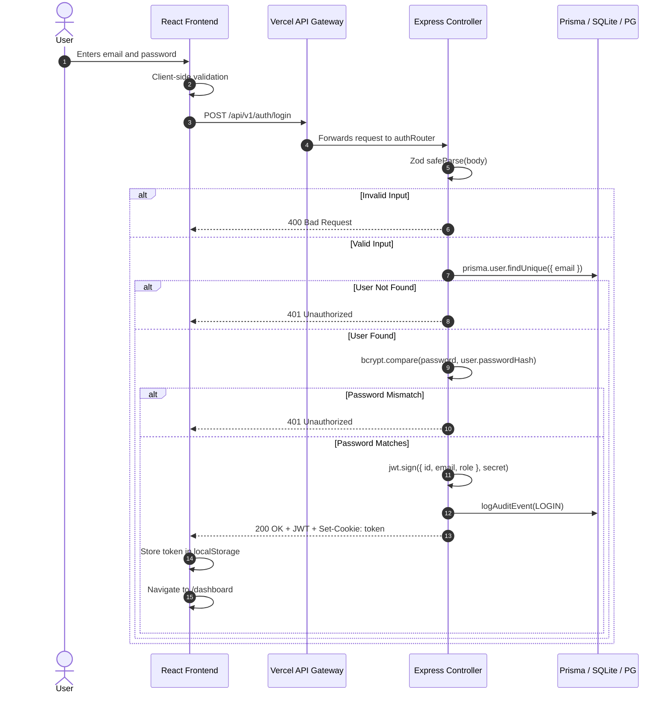

# SuperNexus AI — Authentication Architecture Specification

**System:** SuperNexus AI (RegulaFlow Engine)  
**Document Version:** 2.0  
**Date:** October 31, 2026  
**Security Classification:** Strict Enterprise Confidential  

---

## 1. Authentication Contract (`POST /api/auth/login` & `/api/v1/auth/login`)

The authentication service exposes a unified REST contract adhering strictly to enterprise security guidelines.

### 1.1 Request Specification
* **HTTP Method:** `POST`
* **Path:** `/api/v1/auth/login` (or `/api/auth/login`)
* **Headers:** `Content-Type: application/json`
* **Body Schema:**
  ```json
  {
    "email": "superadmin@supernexus.ai",
    "password": "Password@123"
  }
  ```

### 1.2 Response Specification

#### Success (`200 OK`)
```json
{
  "success": true,
  "message": "Authentication successful",
  "data": {
    "token": "eyJhbGciOiJIUzI1NiIsInR5cCI6IkpXVCJ9...",
    "user": {
      "id": "e9389f41-0775-4b0d-b4b9-12ef2ba5c391",
      "email": "superadmin@supernexus.ai",
      "fullName": "Aarav Singhania (Super Admin)",
      "role": "SUPER_ADMIN",
      "designation": "Chief Regulatory Systems Architect",
      "region": "NORTHERN",
      "departmentId": "4889c2fa-c965-4d7a-a664-969c3a388914",
      "departmentName": "Approval & Regulatory Scrutiny",
      "institutionId": null,
      "institutionName": null,
      "institutionCode": null,
      "permissions": [
        "applications:read:all",
        "applications:assign",
        "compliance:manage",
        "admin:system",
        "users:manage",
        "audit:read"
      ]
    }
  }
}
```
* **HTTP-Only Cookie:** In addition to the token in JSON payload, a secure cookie is set:
  ```
  Set-Cookie: token=eyJhbGci...; Path=/; HttpOnly; SameSite=Lax; Max-Age=604800
  ```

#### Failure Responses
* **`400 Bad Request`**: Malformed payload, invalid email format, or empty password.
  ```json
  { "success": false, "error": "Please enter a valid email address" }
  ```
* **`401 Unauthorized`**: Non-existent user or invalid password.
  ```json
  { "success": false, "error": "Invalid email or password" }
  ```
* **`403 Forbidden`**: Account deactivated by administrator.
  ```json
  { "success": false, "error": "This user account is inactive or disabled. Contact administrator." }
  ```
* **`405 Method Not Allowed`**: Client sends GET, PUT, or DELETE to `/login`.
  ```json
  { "success": false, "error": "Method Not Allowed. Please send a POST request with email and password credentials." }
  ```

---

## 2. Authentication Lifecycle



---

## 3. Session Persistence & Token Verification (`GET /auth/me`)
On application load or browser reload:
1. `AuthContext.tsx` reads `localStorage.getItem('regulaflow_token')`.
2. It sends `GET /api/v1/auth/me` with `Authorization: Bearer <token>`.
3. The server validates token cryptographic signature and expiration.
4. If valid, the current user record is returned and session continues seamlessly.
5. If expired or forged (401), client storage is cleared and user is redirected to `/login`.

---

## 4. Secure Logout (`POST /auth/logout`)
1. Client calls `POST /api/v1/auth/logout`.
2. Server clears the `token` cookie and records an audit log.
3. Client removes `regulaflow_token` and `regulaflow_user` from `localStorage`.
4. State is reset to `user = null` and browser navigates to `/login`.
