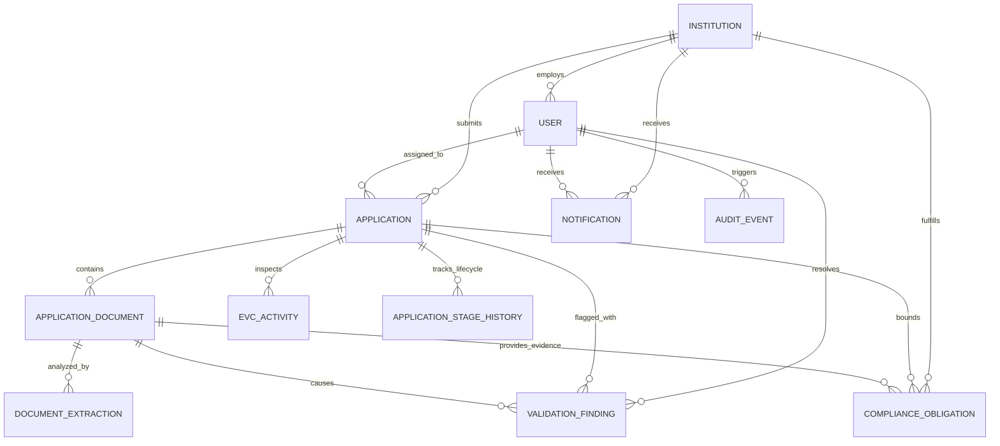

# RegulaFlow AI — Database Schema Documentation
**Problem Statement ID:** SIH26262 | Smart India Hackathon 2026
**Theme:** Smart Automation | **Category:** Software

---

## 1. Relational Schema Architecture

The RegulaFlow AI database supports both a local, zero-setup SQLite database (`prisma/schema.prisma`) for instantaneous hackathon demonstration execution and a complete PostgreSQL schema (`prisma/schema.postgresql.prisma`) for enterprise cloud deployments.



---

## 2. Model Definitions

### `User`
Stores authenticated users across 5 institutional and statutory roles.
- `id` (String, PK, UUID)
- `email` (String, Unique)
- `passwordHash` (String, hashed via bcryptjs / argon2)
- `fullName` (String)
- `role` (`INSTITUTION_USER` | `REGIONAL_OFFICER` | `BUREAU_OFFICER` | `COMMITTEE_MEMBER` | `SYSTEM_ADMIN`)
- `phone` (String, nullable)
- `region` (`NORTHERN` | `WESTERN` | `SOUTHERN` | `EASTERN` | `CENTRAL` | `SOUTH_WESTERN`)
- `institutionId` (String, FK to `Institution.id`, nullable for AICTE officers)
- `active` (Boolean, default true)

### `Institution`
Stores affiliated colleges and universities.
- `id` (String, PK, UUID)
- `code` (String, Unique, AICTE Permanent Institute ID, e.g. `1-109283921`)
- `name` (String, e.g. "Apex Institute of Technology & Engineering")
- `type` (`ENGINEERING_TECH` | `MANAGEMENT` | `PHARMACY` | `POLYTECHNIC` | `ARCHITECTURE_PLANNING`)
- `region` (String)
- `state`, `city`, `address`, `pincode` (Strings)
- `contactEmail`, `contactPhone` (Strings)
- `establishedYear` (Int)

### `Application`
Core approval application lifecycle entity.
- `id` (String, PK, UUID)
- `applicationNumber` (String, Unique, formatted as `AICTE/2026-27/APP-XXXXX`)
- `academicYear` (String, default "2026-2027")
- `category` (`EXTENSION_OF_APPROVAL` | `NEW_INSTITUTION` | `INCREASE_IN_INTAKE` | etc.)
- `currentStage` (`DRAFT` | `SUBMITTED` | `UNDER_SCRUTINY` | `DEFICIENCY_RAISED` | `RETURNED_FOR_CORRECTION` | `RESUBMITTED` | `UNDER_REVIEW` | `AWAITING_EVC` | `AWAITING_DECISION` | `APPROVED` | `REJECTED`)
- `priority` (`NORMAL` | `HIGH` | `URGENT`)
- `institutionId` (String, FK)
- `assignedOfficerId` (String, FK to `User.id`, nullable)
- `submissionDate`, `deadlineDate`, `lastResubmissionDate` (DateTime)
- `programmesData`, `infrastructureData`, `facultyData`, `financialData` (JSON serializations)
- `scrutinyRemarks` (String, nullable)

### `ApplicationDocument`
Uploaded regulatory proofs (Deeds, NOCs, Affidavits).
- `id` (String, PK, UUID)
- `applicationId` (String, FK)
- `documentType` (`LAND_TITLE_LEASE_DEED` | `OCCUPANCY_CERTIFICATE` | `FIRE_SAFETY_NOC` | `BUILDING_PLAN_SANCTION` | `AICTE_UNDERTAKING_AFFIDAVIT` | etc.)
- `fileName`, `originalName`, `mimeType`, `fileSize`, `filePath` (Strings)
- `checksumSha256` (String, ensures document immutability and duplicate prevention)
- `version` (Int, default 1)
- `uploadDate`, `expiryDate` (DateTime)
- `status` (`PENDING_OCR` | `OCR_COMPLETED` | `VERIFIED` | `FLAGGED` | `REJECTED`)

### `DocumentExtraction`
Stores structured results of OCR processing.
- `id` (String, PK, UUID)
- `documentId` (String, FK)
- `rawText` (Text)
- `extractedFieldsJson` (JSON: extracted lessor, lessee, expiryDate, carpetArea, surveyNo)
- `confidenceScore` (Float, 0.0 - 1.0)
- `ocrEngine` (`PDF_TEXT_STREAM` | `TESSERACT_OCR` | `FALLBACK_MOCK`)

### `ValidationFinding`
Evidence-linked deficiencies discovered automatically or by officer scrutiny.
- `id` (String, PK, UUID)
- `applicationId` (String, FK)
- `documentId` (String, FK, nullable)
- `ruleCode` (String, e.g. `VAL_LEASE_EXPIRY`, `VAL_MISSING_FIRE_NOC`)
- `title`, `description` (Strings)
- `severity` (`CRITICAL` | `HIGH` | `MEDIUM` | `LOW`)
- `status` (`OPEN` | `UNDER_REVIEW` | `CONFIRMED` | `DISMISSED` | `RESOLVED`)
- `evidenceExcerpt` (String, citation to exact text extracted)
- `detectedAt`, `resolutionDate` (DateTime)
- `resolvedByUserId` (String, FK)
- `resolutionNotes` (String)

### `ComplianceObligation`
Tracks mandatory legal and regulatory covenants.
- `id` (String, PK, UUID)
- `institutionId` (String, FK)
- `applicationId` (String, FK, nullable)
- `obligationType` (`LEASE_VALIDITY` | `AFFIDAVIT_UNDERTAKING` | `FIRE_SAFETY_RENEWAL` | etc.)
- `title`, `description` (Strings)
- `dueDate` (DateTime)
- `warningDays` (Int, default 30)
- `status` (`ACTIVE` | `DUE_SOON` | `OVERDUE` | `COMPLETED`)
- `evidenceDocumentId` (String, FK to `ApplicationDocument`)

### `EVCActivity`
Expert Visiting Committee inspection sessions.
- `id` (String, PK, UUID)
- `applicationId` (String, FK)
- `committeeType` (`EXPERT_VISITING_COMMITTEE` | `SCRUTINY_COMMITTEE`)
- `scheduledDate` (DateTime)
- `venueOrMode` (`PHYSICAL_INSPECTION` | `VIRTUAL_MEETING` | `HYBRID`)
- `status` (`PROPOSED` | `SCHEDULED` | `IN_PROGRESS` | `COMPLETED` | `RESCHEDULED` | `CANCELLED`)
- `chairmanName` (String)
- `membersJson` (JSON list of experts)
- `checklistJson` (JSON list of items verified)
- `observations` (String)
- `recommendation` (`RECOMMENDED_APPROVAL` | `DEFICIENCY_NOTED` | `RECOMMENDED_REJECTION`)

### `AuditEvent`
Tamper-evident audit record capturing every significant system action.
- `id` (String, PK, UUID)
- `actorId` (String, FK, nullable)
- `actorEmail`, `actorRole`, `action`, `entityType`, `entityId` (Strings)
- `beforeStateJson`, `afterStateJson` (Strings)
- `reason`, `ipAddress`, `userAgent` (Strings)
- `timestamp` (DateTime)

---

## 3. Database Migration & Seeding Commands

```bash
# Push schema into local database
npm run prisma:push

# Generate Prisma Client
npm run prisma:generate

# Populate realistic demonstration data
npm run prisma:seed
```
