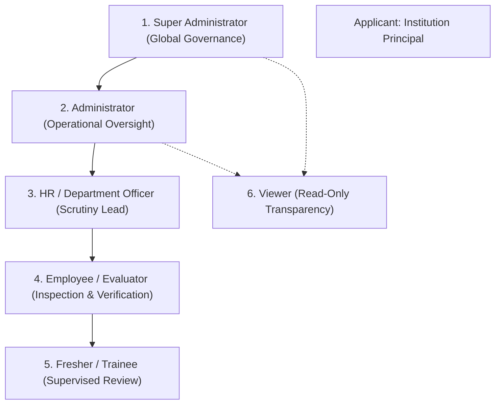

# SuperNexus AI — Role-Based Access Control (RBAC) Permission Matrix

**System:** SuperNexus AI (RegulaFlow Engine)  
**Standard:** Enterprise RBAC Specification (SIH26262)  
**Date:** October 31, 2026  
**Status:** **ACTIVE & ENFORCED**

---

## 1. Enterprise Role Hierarchy

---

## 2. Comprehensive Capability & Route Matrix

| Module / Capability | Super Admin | Admin | HR / Dept Officer | Employee / Evaluator | Fresher / Trainee | Viewer | Institution User |
| :--- | :---: | :---: | :---: | :---: | :---: | :---: | :---: |
| **System Security & Health** | **Full** | Read | Restricted | Restricted | Restricted | Restricted | Restricted |
| **Department Management** | **Full** | Read | View Own | Restricted | Restricted | Restricted | Restricted |
| **User & Role Provisioning** | **Full** | **Full** | Restricted | Restricted | Restricted | Restricted | Restricted |
| **All Applications Scrutiny** | **Full** | **Full** | Assigned Dept | Restricted | Restricted | Read-Only | Restricted |
| **My Applications Filing** | Restricted | Restricted | Restricted | Restricted | Restricted | Restricted | **Full** |
| **Document Upload** | **Full** | **Full** | **Full** | **Full** | **Full** | Restricted | **Full** |
| **Verify / Reject Documents** | **Full** | **Full** | **Full** | Assigned Cases | Supervised | Restricted | Restricted |
| **Raise Document Requests** | **Full** | **Full** | **Full** | **Full** | **Full** | Restricted | Restricted |
| **Assign Document Requests** | **Full** | **Full** | **Full** | Restricted | Restricted | Restricted | Restricted |
| **EVC Inspection Scoring** | **Full** | **Full** | Review | **Full** | Assisted | Read-Only | Restricted |
| **Compliance Trigger** | **Full** | **Full** | Read | Read | Read | Read | Restricted |
| **Immutable Audit Logs** | **Full** | Read | Restricted | Restricted | Restricted | Read-Only | Restricted |

---

## 3. Account Directory & Credentials

All test evaluation accounts share the standard password: `Password@123`

| Role Enum | Demo Identity | Email | Permissions Count | Primary Dashboard |
| :--- | :--- | :--- | :---: | :--- |
| `SUPER_ADMIN` | Aarav Singhania | `superadmin@supernexus.ai` | **32** | Executive Operations Center |
| `ADMIN` | Meera Nambiar | `admin@supernexus.ai` | **26** | Administrative Workspace |
| `DEPARTMENT_OFFICER`| Rajeshwer Sen | `officer.dept@supernexus.ai` | **17** | Department Scrutiny Directorate |
| `EVALUATOR` | Dr. Priya Sundaram | `evaluator@supernexus.ai` | **9** | Evaluator Scrutiny Studio |
| `FRESHER` | Aditya Varma | `fresher@supernexus.ai` | **6** | Learning & Supervised Studio |
| `VIEWER` | Kavita Joshi | `viewer@supernexus.ai` | **3** | Statutory Transparency Desk |
| `INSTITUTION_USER` | Dr. Ramesh Sharma | `institution@regulaflow.aicte.gov.in` | **7** | Institution Approval Portal |
| `REGIONAL_OFFICER` | Sunil Kumar | `officer.north@regulaflow.aicte.gov.in`| **17** | Regional Scrutiny Directorate |

---

## 4. Enforcement Architecture
RBAC is enforced on both frontend and backend boundaries:
1. **Frontend:** [AppLayout.tsx](file:///c:/SIH_NEXUS/apps/web/src/layouts/AppLayout.tsx) computes permitted navigation groups and hides unauthorized menu links. Route components block direct unauthorized access via `user.role` verification.
2. **Backend:** Express middleware `requireRole([...])` and `requirePermission(...)` intercept all HTTP requests. If the authenticated identity lacks the required scope, the request is immediately terminated with `HTTP 403 Forbidden`.
